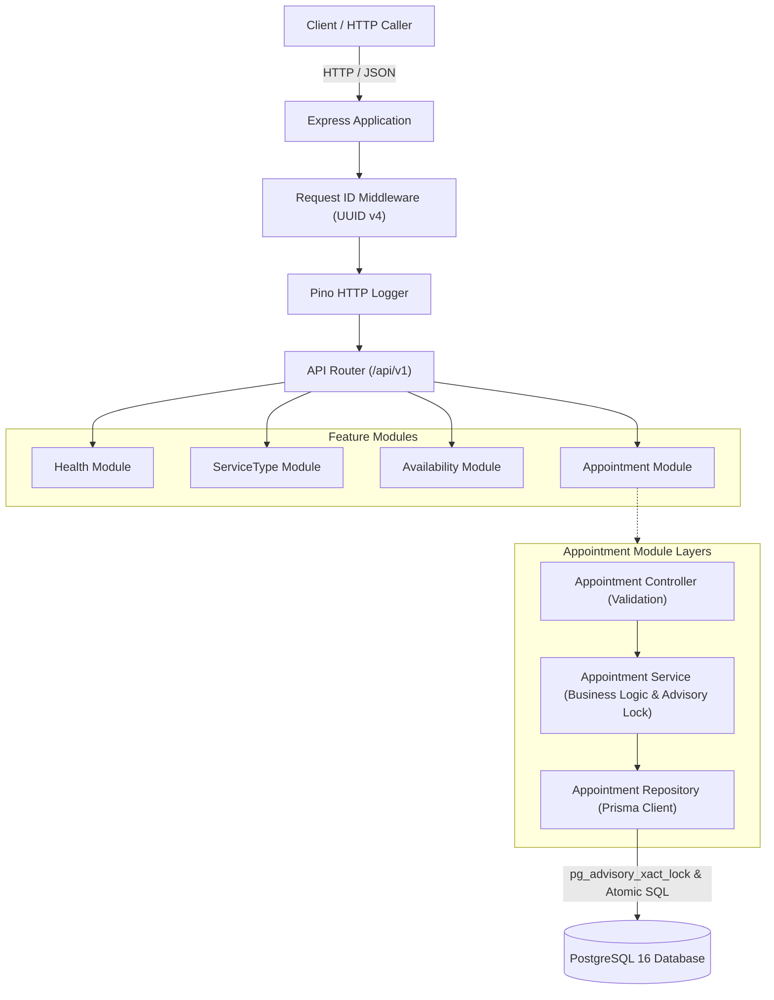
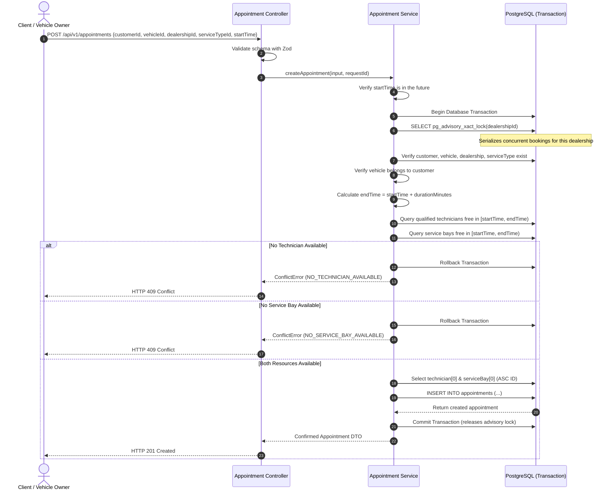
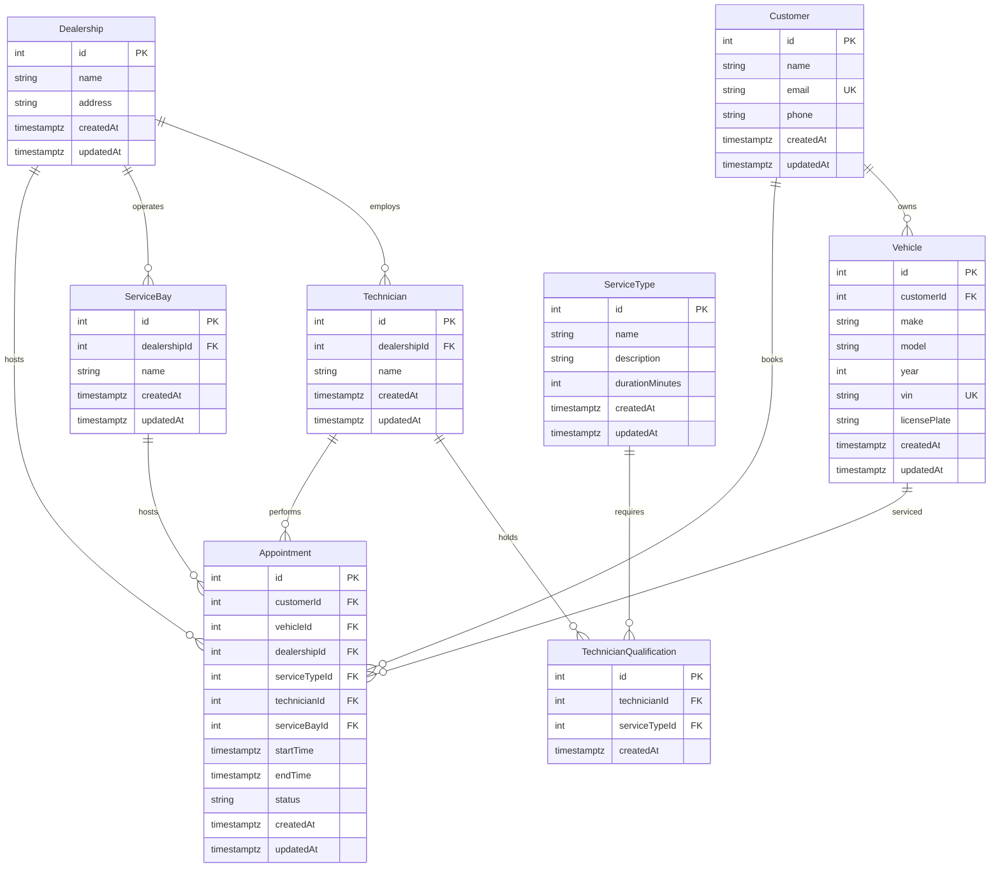

# System Design Document — Keyloop Unified Service Scheduler

## 1. Overview & Objectives

The Keyloop Unified Service Scheduler is a specialized scheduling engine designed for automotive dealerships. Its objective is to allow vehicle owners to book service appointments while automatically and reliably allocating two scarce, concurrent physical resources:
1. An available **service bay** at the designated dealership.
2. A **technician** who belongs to the dealership and is certified/qualified for the specific service type.

The system guarantees that no resource is ever double-booked, even under high concurrent load across distributed clients.

---

## 2. System Architecture

The service adopts a **Modular Monolith** architecture with strict separation of concerns following the `Controller → Service → Repository` design pattern.



---

## 3. Component Responsibilities

| Component | Responsibility |
|---|---|
| **Controllers** | Parse incoming HTTP requests, apply Zod schema validation, map DTOs, and format HTTP responses. |
| **Services** | Enforce business rules, orchestrate multi-step domain flows, manage transaction boundaries, and coordinate concurrency locks. |
| **Repositories** | Encapsulate database queries via Prisma ORM, execute parameterized raw queries for advisory locks, and handle deterministic ordering. |
| **Middleware** | Generate and attach correlation request IDs, log structured HTTP events via Pino, and transform application/validation errors into standard JSON envelopes. |
| **Database** | Store relational state, enforce foreign keys and unique constraints, maintain indexes, and execute transaction-level advisory locks. |

---

## 4. Data Flow & Booking Sequence



---

## 5. Technology Choices & Justifications

- **Node.js LTS & TypeScript (Strict)**: Strong typing across controllers, domain models, and repositories minimizes runtime errors.
- **Express.js**: Lightweight, unopinionated framework suitable for building clean RESTful APIs with minimal overhead.
- **PostgreSQL 16**: Enterprise-grade relational database providing robust ACID transactions and native transactional advisory locks (`pg_advisory_xact_lock`).
- **Prisma ORM**: Type-safe database queries, schema-as-code migrations, and reliable connection pooling.
- **Zod**: Declarative runtime schema validation guaranteeing that untrusted input is validated before entering service layers.
- **Pino & pino-http**: Ultra-low-overhead structured JSON logging with correlation IDs for observability.
- **Docker Compose**: Ensures a reproducible, containerized local PostgreSQL instance without polluting the host operating system.

---

## 6. Database Design



### Critical Indexes Supporting Availability Checks
- `@@index([technicianId, startTime, endTime])` on `Appointment`
- `@@index([serviceBayId, startTime, endTime])` on `Appointment`
- `@@index([dealershipId, startTime, endTime])` on `Appointment`
- `@@unique([technicianId, serviceTypeId])` on `TechnicianQualification`

---

## 7. Concurrency Strategy

### The Double-Booking Challenge
In an appointment scheduling system, two simultaneous booking requests for the same time window can easily inspect current availability, observe that a resource is free, and both attempt to book it. Without synchronization, both succeed, causing a double booking.

### Transaction-Level Advisory Lock Protocol
We use PostgreSQL's built-in transaction-level advisory locks scoped to the dealership:

```sql
SELECT pg_advisory_xact_lock($dealershipId);
```

**Key properties of this approach:**
1. **Scope**: Scoped per `dealershipId`. Bookings across different dealerships run completely concurrently with zero contention.
2. **Lifecycle & Rollback Safety**: An `xact` lock is held exclusively by the database transaction and is automatically released when the transaction terminates (via `COMMIT` or `ROLLBACK`). If any constraint check fails (no technician, no bay, or validation error), Prisma issues an explicit `ROLLBACK`. Zero partial records are written, and the lock is instantly released for subsequent callers.
3. **Internal Verification**: Pre-checks outside the transaction are intentionally omitted for write operations. The entire validation, resource query, selection, and insertion are performed **inside** the advisory-locked transaction.
4. **Deterministic Selection**: Qualified technicians and service bays are ordered by `id ASC`, ensuring deterministic resource allocation.

---

## 8. Scalability, Performance, Reliability & Maintainability

- **Scalability**: Multiple application server instances can run behind a load balancer without distributed lock infrastructure (like Redis or Redlock). PostgreSQL coordinates lock acquisition across all connections.
- **Performance**: High-performance indexes on `(technicianId, startTime, endTime)` and `(serviceBayId, startTime, endTime)` allow the planner to perform quick range scans. Timeouts (`timeout: 15000ms`, `maxWait: 10000ms`) prevent runaway connections.
- **Reliability & Atomic Rollback**: Transaction rollback is comprehensively verified in automated tests. A failed booking releases the advisory lock immediately and leaves total appointment counts untouched.
- **Maintainability & Testing Architecture**: In accordance with the simplified assessment workflow, tests run against the primary `keyloop_scheduler` PostgreSQL database on the `public` schema (`NODE_ENV=test`). Automated tests strictly isolate state by truncating *only* the `Appointment` table and re-seeding the baseline test fixture, leaving all seven domain reference tables completely untouched.
- **Graceful Shutdown**: Handles `SIGINT`/`SIGTERM`, safely draining existing requests and closing Prisma connections.

---

## 9. Observability Strategy

- **Structured Logging**: All logs are emitted in JSON format via Pino.
- **Correlation IDs**: Each incoming request receives a UUID v4 via `requestIdMiddleware` which is included in all downstream log messages.
- **Data Privacy**: Headers like `Authorization` and `Cookie` are redacted. Personal identifiable customer details are omitted from general operational log lines.
- **Future Metrics & Tracing**:
  - Prometheus metrics: `http_request_duration_seconds`, `appointments_booked_total`, `advisory_lock_wait_time_seconds`.
  - OpenTelemetry tracing spans encompassing `HTTP Route -> Service Validation -> DB Transaction (Lock Acquisition) -> DB Insert`.

---

## 10. Assumptions & Trade-offs

1. **Advisory Lock Granularity**: We lock per dealership rather than per technician or per bay. This simplifies the lock acquisition sequence (avoids distributed deadlocks between technician vs bay locks) while providing optimal throughput given dealership-level workloads.
2. **Half-Open Intervals**: Overlaps are evaluated strictly as `[newStart, newEnd)` vs `[existingStart, existingEnd)`. An appointment ending at 10:00 does not conflict with an appointment starting at 10:00.
3. **No Rescheduling or Cancellations in MVP**: As specified in the scope, only confirmed appointments are created.

---

## 11. Generative AI Collaboration & Design Verification

GenAI (Claude Opus & Gemini Flash) was utilized during the architecture and scaffolding phases:
- **Architecture Validation**: Used to cross-verify the advisory lock formula against race conditions in multi-threaded PostgreSQL environments.
- **Schema & Migration Planning**: Generated normalized relational models ensuring proper foreign keys and composite indexes for availability search.
- **Error Detection & Resolution**: Identified and resolved TypeScript 6 compiler deprecations, package version incompatibilities on Node 20 LTS, and Pino HTTP type discrepancies.
- **Human Oversight**: The Project Manager explicitly validated and guided the transition to Docker Desktop on Windows to safeguard local environment stability.
