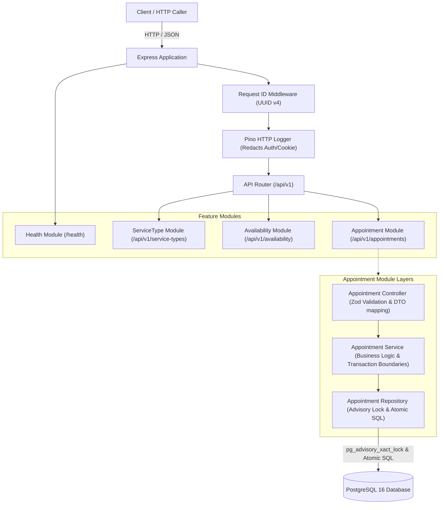
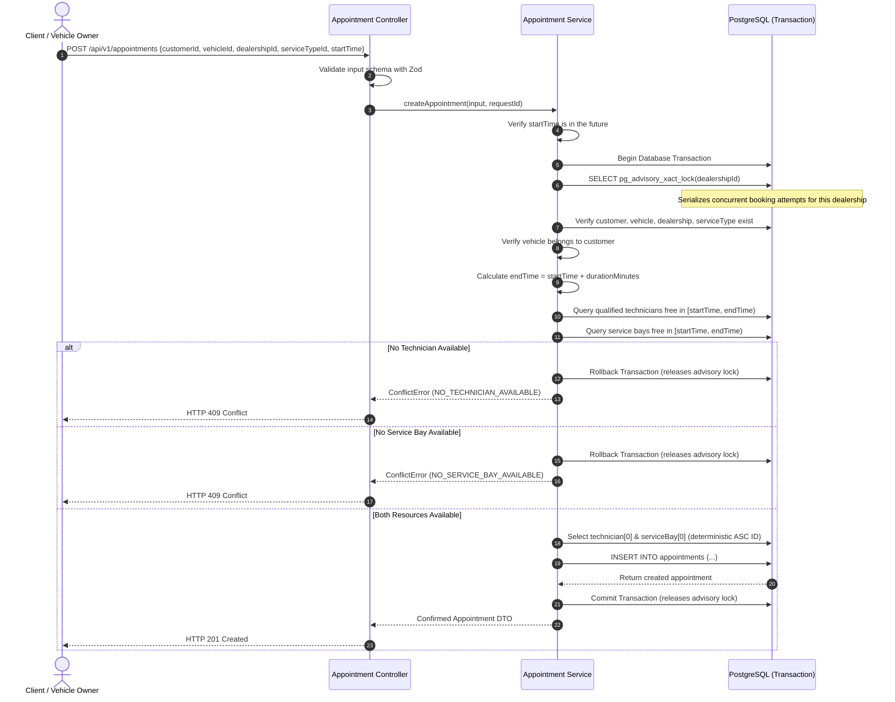
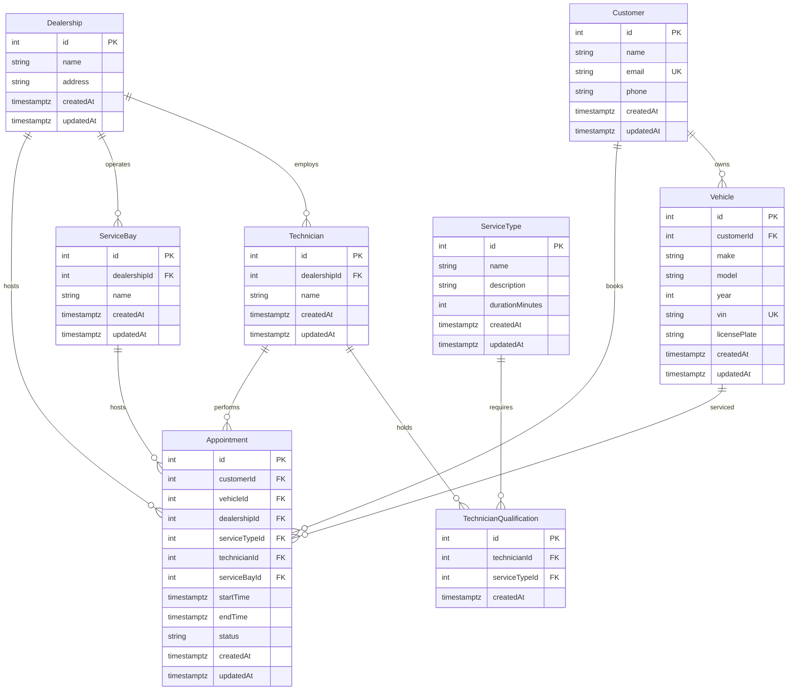

# System Design Document — Keyloop Unified Service Scheduler

## 1. Overview & Objectives

The Keyloop Unified Service Scheduler is a specialized RESTful scheduling engine designed for automotive dealerships. Its objective is to allow vehicle owners to book service appointments while automatically and reliably allocating two scarce, concurrent physical resources:
1. An available **service bay** at the designated dealership.
2. A **technician** who belongs to the dealership and is certified/qualified for the specific service type.

### Concurrency Guarantee & Scope
Double-booking prevention is guaranteed for appointment write paths that participate in the same dealership-scoped advisory-lock protocol. Any direct database writes, out-of-protocol operations, or external updates that bypass this advisory lock protocol are not protected.

---

## 2. System Architecture

The service adopts a **Modular Monolith** architecture with strict separation of concerns following the `Controller → Service → Repository` design pattern.



### Component Responsibilities & Technology Stack

- **Express.js**: Lightweight HTTP framework routing requests through standardized middleware pipelines.
- **Controller Layer**: Parses HTTP parameters and request bodies, invokes Zod validation schemas, and formats responses into standard envelopes (`{ "data": ... }` or `{ "error": { "code", "message" } }`).
- **Service Layer**: Coordinates business workflows, validates business rules, manages transactional boundaries via Prisma, and enforces deterministic resource selection.
- **Repository Layer**: Encapsulates database queries via Prisma ORM and executes raw SQL for database-level advisory locking.
- **PostgreSQL 16 & Prisma ORM**: Relational persistence engine enforcing ACID transactions, foreign keys, unique constraints, and transaction-level advisory locks.
- **Zod**: Declarative runtime schema validation guaranteeing that untrusted input is validated before entering service layers.
- **Pino & pino-http**: Ultra-low-overhead structured JSON logging with correlation IDs.
- **Swagger UI**: Serves interactive API documentation and manual testing at `/api-docs/` loaded from `docs/openapi.yaml`.
- **Docker Compose**: Provides a containerized, reproducible local PostgreSQL 16 instance.

### Distinction: Availability Checks vs. Confirmed Bookings
- **`GET /api/v1/availability`**: Performs a read-only, point-in-time calculation of available qualified technicians and service bays. It **does not acquire locks or reserve resources**. Availability reported by this endpoint can be consumed by other clients before a booking is submitted.
- **`POST /api/v1/appointments`**: The write path that creates confirmed bookings. It does **not** rely on previous availability checks; it **independently re-validates all constraints and resource availability inside an advisory-locked database transaction**.

---

## 3. Data Flow & Booking Sequence



---

## 4. Domain Model & Database Design



### Critical Indexes Supporting Availability Lookups
- `@@index([technicianId, startTime, endTime])` on `Appointment`
- `@@index([serviceBayId, startTime, endTime])` on `Appointment`
- `@@index([dealershipId, startTime, endTime])` on `Appointment`
- `@@index([customerId])` on `Vehicle`
- `@@index([dealershipId])` on `Technician` and `ServiceBay`
- `@@unique([technicianId, serviceTypeId])` on `TechnicianQualification`

---

## 5. Concurrency Strategy & Advisory Locking Protocol

### The Concurrency Challenge
When multiple clients attempt to schedule appointments for the same dealership during overlapping time slots, concurrent transactions can easily read the same available technician and service bay before either transaction commits. Without synchronization, both transactions would persist conflicting appointments, resulting in a double-booking defect.

### Transaction-Level Advisory Lock Protocol
To prevent this, every write path creating appointments acquires a PostgreSQL transaction-level advisory lock scoped to the requested dealership ID:

```sql
SELECT pg_advisory_xact_lock($dealershipId);
```

#### Protocol Sequence inside `AppointmentService.createAppointment`:
1. **Begin Transaction**: An ACID transaction is opened via `prisma.$transaction`.
2. **Acquire Dealership Advisory Lock**: `tx.$executeRaw\`SELECT pg_advisory_xact_lock(${dealershipId})\``.
   - All concurrent write operations targeting the **same dealership** queue on this lock.
   - Separate dealerships use distinct lock keys (`dealershipId`), allowing them to proceed in parallel without artificial cross-dealership contention.
3. **Re-Validate Constraints Inside Lock**: The transaction rechecks entity existence, vehicle ownership, and resource availability directly against current committed state.
4. **Deterministic Allocation**: Available qualified technicians and available service bays are filtered by `[startTime, endTime)` overlap and selected using `id ASC`.
5. **Persist Appointment**: The appointment is created with status `CONFIRMED`.
6. **Commit or Rollback**:
   - On success, the transaction commits, persisting the booking and automatically releasing the advisory lock.
   - On business conflict or unexpected error, the transaction rolls back. A failed transaction persists zero new records, while previously committed appointments remain intact; the advisory lock is automatically released.

#### Concurrency Scope & Architectural Trade-offs
- **Guaranteed Scope**: Concurrency safety is strictly guaranteed for appointment write operations executed through this protocol. Writes that bypass this protocol (e.g. direct database modifications) are not protected.
- **Dealership-Level Granularity**: Serializing bookings at the dealership level simplifies correctness by completely eliminating the risk of distributed deadlocks between technician locks and bay locks. However, this introduces an intentional throughput trade-off: all bookings for a single dealership are serialized, regardless of whether they target different bays or technicians.
- **Shared Infrastructure**: While different dealerships use different advisory lock keys, all transactions share PostgreSQL server resources (connection pool, CPU, memory, and disk I/O). High concurrency across multiple dealerships will still compete for database worker processes.
- **Advisory Lock Execution via `$executeRaw`**: PostgreSQL's `pg_advisory_xact_lock` returns `void`. Prisma's `$queryRaw` throws a column deserialization error when processing `void`. The repository therefore uses `tx.$executeRaw`, which executes the parameterized query safely without attempting to map a return value.

---

## 6. Business Rules & Domain Assumptions

The implementation strictly satisfies all required business rules:

1. **Entity Linking**: Each appointment explicitly links six entities: one Customer, one Vehicle, one Dealership, one ServiceType, one Technician, and one ServiceBay.
2. **Service Duration**: Appointment duration is dictated exclusively by `ServiceType.durationMinutes`. The end time is calculated as `startTime + durationMinutes * 60 * 1000`.
3. **Technician Qualification & Dealership**: Assigned technicians must belong to the requested Dealership (`technician.dealershipId === dealershipId`) and possess a verified qualification for the requested ServiceType (`TechnicianQualification` record exists).
4. **Service Bay Assignment**: Assigned service bays must belong to the requested Dealership (`serviceBay.dealershipId === dealershipId`).
5. **Dual-Resource Availability**: Both the technician and the service bay must have zero overlapping confirmed appointments over the entire service interval.
6. **Half-Open Intervals `[startTime, endTime)`**: Overlap is evaluated strictly using `newStart < existingEnd AND newEnd > existingStart`. Strictly adjacent appointments (e.g. `10:00–10:30` and `10:30–11:00`) are valid and permitted.
7. **Timezone & UTC Handling**: Timestamps are persisted in PostgreSQL with timezone awareness (`@db.Timestamptz`) in UTC. Incoming request timestamps must be valid ISO 8601 strings with timezone offsets (e.g., `2026-11-05T09:00:00+07:00`).
8. **Future Start Times**: Past appointment start times are strictly rejected with HTTP 400 (`PAST_START_TIME`).
9. **Out of MVP Scope**: Working hours schedules, dealership holidays, technician shift patterns, leave management, appointment cancellation, rescheduling, customer authentication/authorization, notifications, and payment processing are out of scope.
10. **Assessment Environment Context**: A single PostgreSQL database supports this assessment. No multi-node cluster, read-replica pool, or production load benchmark has been conducted.

---

## 7. Quality Attributes & Testing Evidence

### Observability
- **Structured Logging**: Emitted as JSON via Pino.
- **Request IDs**: `requestIdMiddleware` uses a supplied `X-Request-Id` header when present, or generates a UUID otherwise. The ID is attached to request logging and included in structured error log entries. The error response bodies do not include the request ID.
- **Privacy Controls**: In `src/lib/logger.ts`, request headers `Authorization` and `Cookie` are redacted as `[REDACTED]`. Pino HTTP logs request metadata, including headers, but does not log the request body; the two sensitive headers are censored.
- **Future Enhancements (Planned / Not Implemented)**:
  - Prometheus metrics: `http_request_duration_seconds`, `appointments_booked_total`, `advisory_lock_wait_time_seconds`.
  - OpenTelemetry distributed tracing spans covering HTTP Route → Service Validation → Advisory Lock Wait → DB Commit.

### Reliability & Transaction Rollback
- Automatic transaction rollback on any validation failure or conflict guarantees that no partial or orphaned records are written.
- Advisory locks held at the transaction level (`xact`) are automatically cleared by the PostgreSQL engine upon transaction termination, eliminating orphan locks even in the event of Node.js process crashes.

### Testing Evidence
Automated tests provide three complementary categories of evidence:
1. **Business Rule Validation Tests**: Integration tests verifying qualification mismatch rejection, vehicle-customer mismatch rejection, past start time rejection, partial overlap rejection, full overlap rejection, and adjacent appointment acceptance.
2. **Concurrent Booking Integration Tests**: Parallel requests (`Promise.all`) targeting a dealership containing exactly 1 qualified technician and 1 service bay. Tests verify that under real PostgreSQL advisory locking, exactly 1 appointment is confirmed (HTTP 201) and all other overlapping attempts receive HTTP 409 Conflict.
3. **Rollback-after-INSERT Tests**: A dedicated transaction integration test inserts an appointment inside a real active transaction, deliberately throws an error before `COMMIT`, and confirms that this new appointment was not persisted and the total appointment count remained unchanged. Existing committed appointments remain in the database.

---

## 8. Scalability, Performance & Maintainability Considerations

- **Throughput Bottlenecks**: Serializing bookings by dealership ID bounds concurrency per dealership to the duration of one booking transaction. Under high dealership volume, transactions should be kept minimal (avoiding external network calls inside the transaction).
- **Shared Development & Testing Strategy**: In accordance with the simplified assessment workflow, tests run against the primary `keyloop_scheduler` PostgreSQL database on the `public` schema (`NODE_ENV=test`). Automated tests strictly isolate state by truncating *only* the `Appointment` table and restoring baseline fixtures, leaving all seven domain reference tables completely untouched.
- **Graceful Shutdown**: The server handles `SIGINT` and `SIGTERM` signals by draining active HTTP connections and disconnecting Prisma Client safely.

---

## 9. Generative AI Collaboration & Engineering Oversight

I approached design as the **human Project Manager (PM)** of an AI-assisted workflow. I selected the backend of Scenario A and defined priorities and acceptance criteria. I used **ChatGPT as my AI Solution Architect (SA)** for architectural reasoning, risk assessment, and design/code review, while **Anti served as my AI developer agent** to implement the codebase, tests, and documentation. I reviewed feedback and retained responsibility for deciding which solutions and trade-offs to accept; I do not claim to have personally authored all implementation files.

### AI assistance during the design phase

I translated the requirements into a reproducible REST backend with persistent PostgreSQL records, a qualified technician and service bay available throughout the entire appointment, and atomic booking creation. I discussed separation of concerns with the SA and adopted a **modular monolith** using Controller → Service → Repository layers, choosing maintainability and simplicity for a time-boxed assessment. I chose Docker Desktop for local PostgreSQL on Windows rather than a host installation. Anti implemented the corresponding Prisma schema, APIs, migration/seed scripts, and tests under that scope.

A key design risk was concurrent requests selecting the same available resources. The adopted transaction-level **dealership-scoped PostgreSQL advisory lock** serializes participating booking writers, allowing a fresh qualification/availability check and INSERT within the same transaction. SA review emphasized the scope of this guarantee: it does not protect direct writers bypassing the lock protocol, and dealership-level serialization reduces throughput. The read-only availability endpoint is explicitly non-reserving.

### Design challenges, revisions, and quality ownership

1. **Dependency and runtime feedback:** Anti investigated package compatibility with Node 20.11 and repaired Prisma advisory-lock `void` deserialization by using `$executeRaw` instead of `$queryRaw`. The Express 5 `req.query` getter required a validation middleware change. Reported build and test results informed acceptance.
2. **P1 — destructive seeding:** SA review identified the initial full-table `TRUNCATE ... RESTART IDENTITY CASCADE` as a data-loss risk. I prioritized correction and delegated the change to Anti. The final seed uses non-destructive, idempotent reference-data operations. This intentionally supersedes the historical seed implementation recorded in the AI collaboration log.
3. **P2 — direct rollback evidence:** SA review identified that HTTP 409 conflict behavior did not prove a transaction would roll back after INSERT. I required Anti to add a real Prisma transaction test that inserts a new appointment, deliberately fails before commit, and checks that the new row is absent while committed data is unchanged.
4. **Testing trade-off:** I chose a shared local database/schema for the assessment workflow. Automated tests explicitly reset only Appointment, which can remove development bookings; this is documented in the README rather than concealed.

### How I evaluated the result

I relied on business-rule integration tests, appointment persistence/relationship assertions, time-interval overlap tests, a five-request real-database concurrency test (**one success and four conflicts**), and rollback-after-INSERT evidence. Anti's recorded final verification reported **26 passing tests across eight test files on two consecutive runs**, plus successful lint and build checks. These are historical results from development, not new tests executed during documentation review.

I used AI to accelerate architecture exploration, implementation, and debugging, but retained ownership by specifying outcomes, examining technical evidence, prioritizing design corrections, and acknowledging limitations. Detailed chronological evidence is in [AI_COLLABORATION_LOG.md](AI_COLLABORATION_LOG.md).
